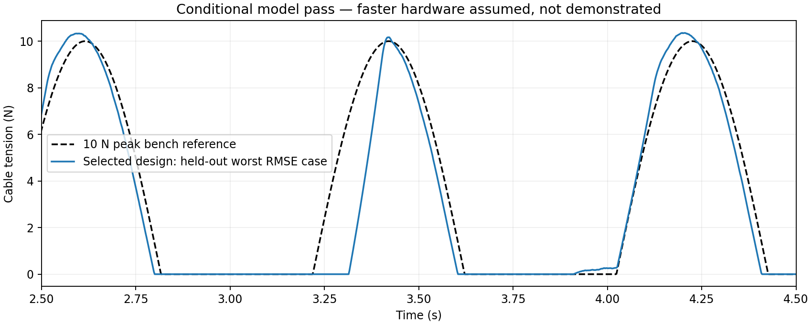
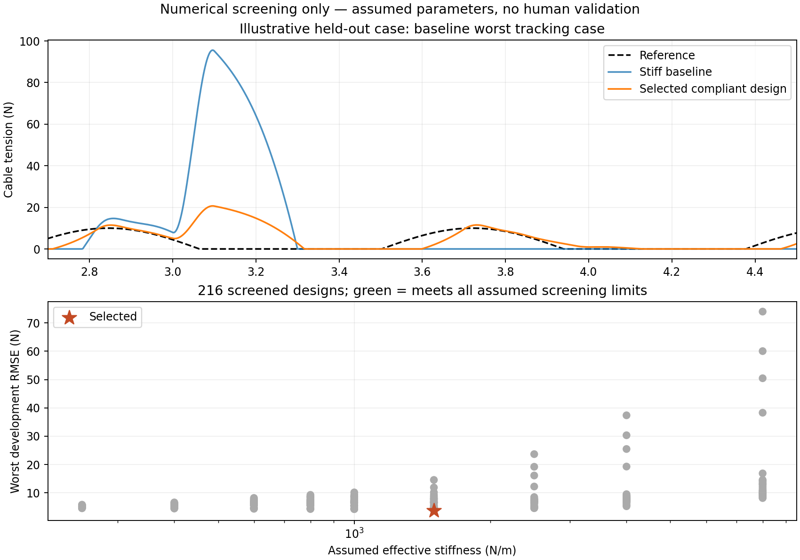

# Hip-Assistance Transmission: Simulation Delivery

Status: executable numerical screening completed on November 15, 2026. No physical device or patient testing is represented by these results.

## Decision

**Do not purchase a complete exoskeleton or assume a generic low-cost motor setup is adequate.** The broad, slower-hardware envelope failed all 216 screened configurations.

**A compliant transmission with path-offset estimation is a conditionally feasible bench-module candidate in the simplified model.** A second screen specifies faster hardware assumptions and finds a passing configuration. These hardware response bounds have not been demonstrated by a selected motor/sensor combination. This is a model-based component specification, not a validated build recommendation or an originality claim.

## Reproduce

```bash
python -m pip install -r requirements.txt
python simulate.py --out results
python run_envelope.py --out results
```

Run from this directory. Random seeds are fixed. The first script screens 216 configurations; the second screens 24 configurations under revised hardware assumptions. The held-out random validation cases are not used to choose gains or stiffness. The faster envelope itself was introduced after the original envelope failed, so this is iterative model development, not a preregistered confirmatory study.

## Model-based results

| Screen | Configurations | Development cases per configuration | Held-out cases for selected configuration | Result |
| --- | ---: | ---: | ---: | --- |
| Broad hardware envelope | 216 | 64 | 96 | No configuration passes all development limits; selected fallback also fails validation |
| Faster specified hardware envelope | 24 | 16 unique | 96 | 14 pass development; selected configuration passes the model screen in validation |

The broad screen's selected design is only the lowest-RMSE fallback because no feasible design exists. A lower error or lower peak than the baseline is not sufficient to declare it feasible.

### Selected faster-envelope configuration

- Effective series stiffness: **800 N/m (0.8 N/mm)**.
- Proportional force correction gain: **1.0**, normalized by assumed stiffness.
- Integral gain: **0**.
- Model-based path-offset observer enabled, with fixed nominal servo feedforward.
- Assumed spool travel: **100 mm total**, centered about zero.
- Assumed actuator position-servo time constant: **at most 25 ms**. This is not settling time.
- Assumed complete sensing/control delay: **at most 10 ms**.
- Assumed spool linear speed capability: **at least 0.16 m/s**.
- Bench reference peak force: **10 N**, not a human assistance prescription.

| Validation metric, worst case across 96 assumed conditions | Selected compliant configuration | Tuned stiff comparator, same faster envelope |
| --- | ---: | ---: |
| Force-tracking RMSE | 0.900 N | 4.620 N |
| Peak cable tension | 13.382 N | 48.604 N |
| Maximum elastic extension | 19.366 mm | 6.107 mm |
| Maximum absolute spool displacement | 34.665 mm | 20.630 mm |

The comparator uses 8000 N/m stiffness and the best available proportional gain in the second-stage sweep. It also receives the observer and feedforward option. It is **not a commercial product** and is not claimed to be an optimally controlled rigid actuator. High model peaks may be unrealistic where a real motor would torque-saturate; the model does not include motor torque saturation.





## Assumptions and model equations

The joint trajectory is prescribed, rather than computed from human or coupled leg dynamics. A unilateral elastic cable transmits tension only:

```text
F = max(0, k_actual * (x - r*theta - path_offset))
xdot = clip((x_command - x)/tau, -speed_limit, speed_limit)
x_command = clip(r*theta_delayed + F_reference/k
                 + gain*(F_reference-F_delayed)/k
                 + bounded_integral + observer_terms,
                 -stroke/2, stroke/2)
```

The observer estimates a path offset from delayed position, angle and force while the cable is tensioned. It uses a 30 ms filter and a bounded offset. Feedforward uses a fixed nominal 45 ms servo constant, not the actual case-specific value. See source for the exact implementation.

Assumed screening limits, selected for this bench study, are worst-case RMSE <= 2.5 N, peak force <= 20 N, elastic extension <= 40 mm, and absolute spool displacement < 49.9 mm. These are **not medical safety limits or clinically validated tolerances**.

Broad development cases vary frequency (0.7/1.2 Hz), servo time constant (25/65 ms), delay (8/32 ms), speed capability (0.08/0.16 m/s), path-length shift (4/10 mm), and shift direction. A smooth 100 ms path shift occurs after 3 seconds.

Held-out cases use continuous parameter ranges, including frequencies 0.6–1.3 Hz and shifts of 3–12 mm, plus +/-20% effective stiffness mismatch and 0.10 N standard-deviation force measurement noise. The faster envelope constrains actuator time constant, delay and speed as stated above while retaining the geometry disturbance. Each simulation lasts eight seconds; metrics exclude the first second.

## Numerical checks

- Zero reference, stationary joint, no disturbance: exactly zero force and error.
- Time-step refinement for the selected faster-envelope design over its development cases: worst RMSE 0.870785 N at 2 ms and 0.870716 N at 1 ms; peak 11.8830 N and 11.9104 N respectively.
- This checks numerical consistency, not physical accuracy.

## Excluded physics and implications

No human balance, motor electrical dynamics, torque/power limit, detailed Bowden friction/hysteresis, fabric slip model, impact dynamics, sensor calibration drift, or long-term wear is modeled. A changing path offset is a simplified disturbance and is not a full friction model.

The model supports screening a transmission/control concept. It does not establish wearable mass, price, gait improvement, fall protection, independent toileting, patient suitability, or physical prototype safety. A real actuator's ability to meet the response specification under load remains unresolved.

## Originality research: what has already been ruled out

| Idea | Existing evidence | Conclusion |
| --- | --- | --- |
| Cable-driven hip assistance | Harvard/BU 2024 soft robotic apparel study | Not a new product category |
| Optimizing Bowden routing and friction | 2022 force-transmission optimization research | Too broad to claim novelty |
| Adding series elasticity | Existing soft-exosuit actuator literature | A spring alone is not a contribution |
| Modular instrumented test bench and clutches | Sensors 2023 modular test-bench study | Test-rig construction alone is not novel |
| Model-based tension estimation/compensation | Wearable Technologies 2025 study | Observer/controller concept itself is established |
| Low-cost printed research platforms | PETRA 2026 | Low-cost or printed alone is insufficient |

**No patent-level breakthrough has been established.** The narrowed candidate is a reproducible module combining compliance, low inactive resistance objectives, and load/path uncertainty evaluation. Novelty must be tied to a specific subsequent mechanism or result, not this generic combination. Inactive resistance, power-loss release, and fall protection are not evaluated by this model.

## Sources

- [Harvard/BU soft robotic hip assistance, Nature Medicine](https://www.nature.com/articles/s41591-023-02731-8)
- [Bowden force transmission analysis and optimization, 2022](https://onlinelibrary.wiley.com/doi/10.1155/2022/5552166)
- [Modular exosuit test bench, Sensors 2023](https://www.mdpi.com/1424-8220/23/10/4713)
- [Sensorless model-based tension control, Wearable Technologies](https://www.cambridge.org/core/journals/wearable-technologies/article/sensorless-modelbased-tension-control-for-a-cabledriven-exosuit/05655EA5E1B685824928A869172A4041)
- [PETRA test platform, Frontiers 2026](https://www.frontiersin.org/journals/rehabilitation-sciences/articles/10.3389/fresc.2026.1859475/full)
- [OpenExo university project](https://theopenexo.nau.edu/)

## Authorship and next decision

This literature screen, code and report were generated by an AI assistant at the family's request. They are starting materials, not Linda's independently completed research or experiments. Linda can learn from, modify and extend them, with contributions accurately attributed.

The delivered decision is conditional feasibility of a small bench module, and rejection of the original loose hardware specification. It is not a recommendation to build a human-supporting device. Before procurement, match actual components to the derived response requirements and extend the model to include their measured or manufacturer-specified dynamics, torque/current limits and friction.
